# Task 5: Automation: Repository and Pipeline Design (AWS)

## 5.1 Repository strategy

| Repository | Content | Owners (CODEOWNERS) | Deploys to |
|---|---|---|---|
| `platform-org` | OUs, SCPs, Config org rules, org trail | Platform + Security | Management, Audit, Log Archive |
| `platform-network` | TGW, inspection, DNS, spoke-vpc module | Network | Network Hub, spoke VPCs in workload accounts |
| `platform-modules` | Versioned, reusable modules (tagged `v1.4.0`) | Platform | n/a (consumed by others) |
| `payments-infra` | EKS, Aurora, ALB, app IAM roles | Payments team (+ Platform as reviewer) | Payments-Dev/Staging/Prod |

This submission is a **mono-repo extract** of these for readability. The split exists so that repository permissions mirror the "app teams cannot change guardrails or hubs" constraint: the Payments team has no write access to `platform-org` or `platform-network`, and their deploy roles cannot change those resources even if they tried (SCP).

Layout per stack:

```
terraform/workloads/payments/
├── main.tf            # same code for every environment
├── variables.tf
└── envs/
    ├── dev/   { backend.hcl, terraform.tfvars }
    └── prod/  { backend.hcl, terraform.tfvars }
```

**One codebase, many environments.** Promotion means running the **same commit** with a different `envs/<env>` directory, never copy-pasting code between folders. Modules are pinned by version tag, so a module change reaches prod only when prod's caller is bumped.

## 5.2 Pipeline (Jenkins)

Full pipeline: [`Jenkinsfile`](../Jenkinsfile).

```mermaid
flowchart LR
  PR["Pull request"] --> CI["Validate: fmt, validate, tflint"]
  CI --> SEC["Policy checks: Checkov + Conftest (OPA)"]
  SEC --> PLAN["terraform plan -out<br/>plan.json uploaded to evidence bucket"]
  PLAN --> REVIEW["Peer review on PR<br/>(CODEOWNERS, plan posted)"]
  REVIEW --> MERGE["Merge to main"]
  MERGE --> DEV["Apply dev (auto)"]
  DEV --> STG["Plan + approve + apply staging"]
  STG --> PROD["Plan prod → 2-person approval → apply saved plan"]
  PROD --> EVID["Evidence: plan, approvals, logs → S3 Object Lock"]
```



| Stage | Tool / AWS service | Fails the build when |
|---|---|---|
| Format and validate | `terraform fmt -check`, `terraform validate`, `tflint` (AWS ruleset) | Syntax, invalid instance types, deprecated args |
| Static policy | **Checkov** on HCL | Unencrypted storage, public resources, missing logging |
| Plan policy | **Conftest (OPA/Rego)** on `terraform show -json plan` (see [`policy/`](../policy/)) | Plan adds route to IGW in CDE, deletes Aurora, creates IAM role without boundary, missing mandatory tags |
| Plan | `terraform plan -out=tfplan` | Error, or drift in prod not explained by the change |
| Peer approval | GitHub branch protection (1 CODEOWNER review, signed commits, status checks required) + Jenkins `input` step restricted to approver group, **approver ≠ commit author** | No approval within 24 h → pipeline aborts |
| Apply | `terraform apply tfplan` (the **exact reviewed plan**, not a fresh one) | Plan file stale (state changed since plan) → Terraform refuses |
| Post-apply | Smoke tests, Reachability Analyzer check, `terraform plan -detailed-exitcode` must be 0 | Any residual diff |
| Evidence | Upload to S3 evidence bucket | Upload failure fails the build |

**Why Jenkins, and the AWS-native alternative.** Jenkins was chosen because it is already the organisation's CI standard and runs inside our Shared Services account on our own agents (so credentials never leave AWS). The AWS-native equivalent is **CodePipeline + CodeBuild** with a **manual approval action**, which gives IAM-native approvals and built-in CloudTrail records of who approved, with less to patch. The trade-off: Jenkins needs controller hardening, plugin patching and backup, which is operational work we accept for consistency with existing pipelines.

## 5.3 Credentials (no long-lived keys)

```
Jenkins agent (EKS pod / EC2 in Shared Services)
  └─ instance role / Pod Identity: jenkins-agent
       └─ sts:AssumeRole → arn:aws:iam::<prod>:role/terraform-deploy
            session name: jenkins-<job>-<build>   ← appears in CloudTrail
            source identity: <approver email>    ← persists through role chain
```

The `terraform-deploy` role trust policy only allows the `jenkins-agent` role, and requires `sts:SourceIdentity` to be set. In CloudTrail, every production API call therefore shows **which build** made it and **who approved** it. That is the "traceable" constraint.

Alternative where Jenkins is outside AWS: GitHub Actions OIDC federation to IAM. Static access keys in Jenkins credentials are used **only in the personal lab** (see `lab/`), never for real environments.

## 5.4 State management

| Requirement | Implementation |
|---|---|
| Remote, shared state | S3 backend, one bucket per account (state lives with the resources it describes) |
| Locking | **S3 native lockfile** (`use_lockfile = true`, Terraform ≥ 1.10). DynamoDB locking is deprecated in recent Terraform versions and not needed |
| Encryption | SSE-KMS with a dedicated CMK; key policy grants decrypt only to `terraform-deploy` and Security read role. **State contains secrets** (for example DB passwords if not using managed secrets), so it is treated as sensitive data |
| Recovery | **S3 versioning** on; every apply creates a new object version; lifecycle keeps 90 days of non-current versions |
| Isolation | Separate state key per stack per env (`payments/prod/terraform.tfstate`); a broken dev state cannot affect prod |
| Access | Bucket policy denies all principals except deploy role, break-glass, and Security read; denies non-TLS |

See [`terraform/bootstrap/`](../terraform/bootstrap/).

## 5.5 Rollback

Infrastructure rollback is **roll-forward from Git**: Terraform has no "undo", so rollback means applying a previous known-good configuration.

| Situation | Rollback method |
|---|---|
| Bad change, resources still healthy | `git revert <commit>` → PR → pipeline → apply. Same approvals, same evidence |
| Urgent production impact | Re-run the pipeline for the **last successful prod build's commit SHA** (Jenkins parameter `GIT_REF`), emergency approval by IC |
| Corrupted state file | Restore previous S3 object version of the state, then `terraform plan` to confirm it matches reality |
| Destructive change (data) | Prevented at plan: Conftest denies `delete` on Aurora/S3 data stores; `deletion_protection = true` and `lifecycle { prevent_destroy = true }` in code; if it still happens, restore from AWS Backup (Task 2) |
| Application release | EKS rolling/canary via Argo Rollouts; automatic rollback on error-rate SLO breach |

## 5.6 Evidence retention

| Evidence | Store | Retention |
|---|---|---|
| Plan binary + `plan.json` + policy check results | S3 evidence bucket (Log Archive account), **Object Lock compliance** | 7 years |
| Jenkins console log and approval record (approver, timestamp, build ID, commit SHA) | Same bucket, written by the pipeline | 7 years |
| Git history and PR reviews | GitHub (signed commits, branch protection) | Life of repo; exported quarterly to evidence bucket |
| API activity | Org CloudTrail + CloudTrail Lake | 7 years |
| Resource configuration history | AWS Config (delivered to Log Archive) | 7 years |

An auditor can take any production resource change in CloudTrail, read the session name (`jenkins-payments-prod-142`), and retrieve build 142's commit, plan, policy results and approver from the evidence bucket. That chain is the evidence that **all production changes are traceable and automated**.

## 5.7 Scheduled drift detection

A separate Jenkins job runs hourly per stack: `terraform plan -detailed-exitcode -lock=false`. Exit code `2` (changes present) raises a CloudWatch metric `TerraformDrift=1` and an alert to the owning team. This complements the real-time EventBridge detection in Task 4.
