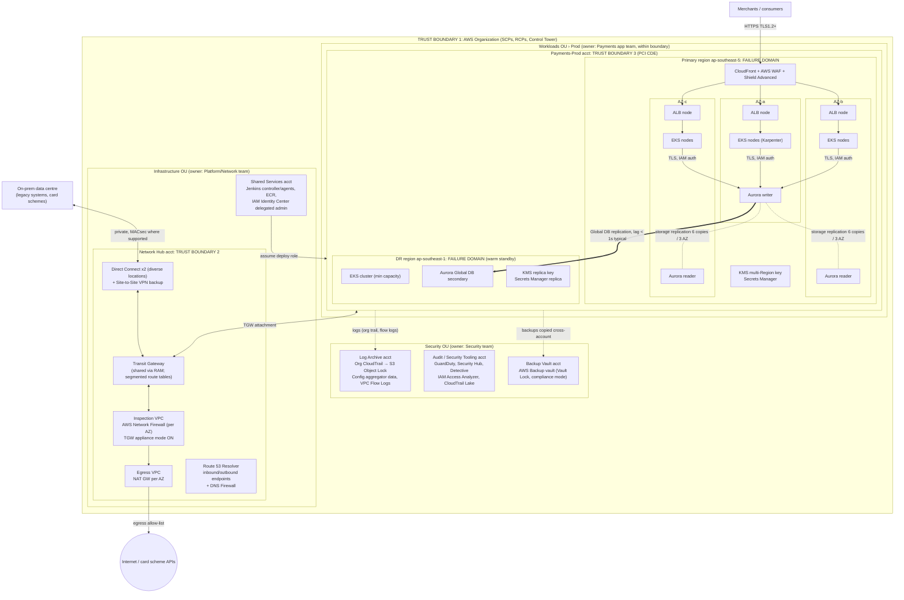
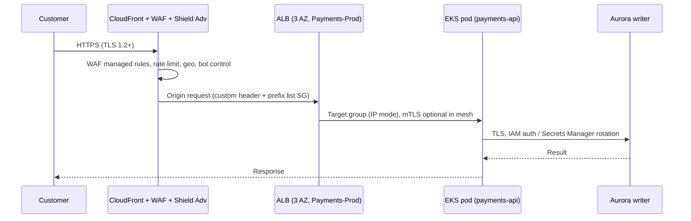
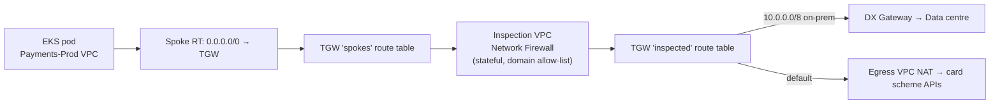
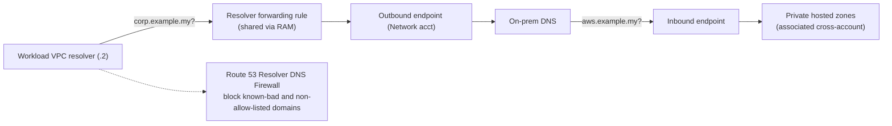
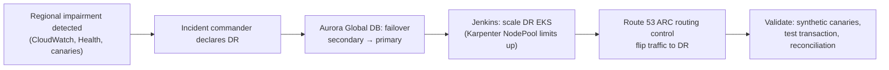

# Architecture and Traffic-Flow Diagrams (AWS)

Diagrams are Mermaid and render natively on GitHub.

**Regions (assumption, see [assumptions](assumptions.md)):** primary `ap-southeast-5` (Malaysia), DR `ap-southeast-1` (Singapore). Regional service availability must be confirmed before build.

## 1. Mandatory architecture diagram

Shows trust boundaries (dashed boxes), failure domains (AZs and regions), security controls and key services.

### Trust boundaries and ownership

| Boundary | What it separates | Enforced by | Who can change it |
|---|---|---|---|
| 1. Organization | Our estate vs. everything else | SCPs, RCPs, Control Tower controls, org trail | Platform team via pipeline in Management account only |
| 2. Network hub | Shared connectivity vs. workloads | Separate account, TGW route tables, SCP denies network edits in workload OUs | Network team via pipeline |
| 3. PCI CDE (Payments-Prod) | Cardholder data vs. non-CDE | Dedicated account, Network Firewall policy, security groups, KMS key policies | Payments team (workload resources only, inside permission boundary) |
| Security OU | Evidence vs. everyone being audited | Object Lock, Vault Lock, SCP deny-delete, no app-team access | Security team only |

## 2. Traffic flows

### 2a. North-south ingress (customer payment request)

ALB security group only allows the CloudFront managed prefix list, so the origin cannot be reached directly.

### 2b. East-west and hybrid (to on-prem and card schemes)

Spoke VPCs have no Internet Gateway and no NAT. The only path out is via the TGW to inspection, and spokes cannot route to each other without passing the firewall.

### 2c. DNS resolution

### 2d. Disaster-recovery failover flow

